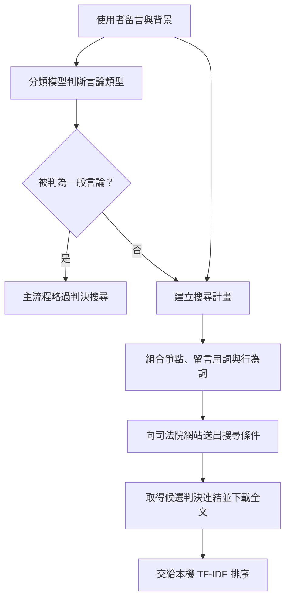
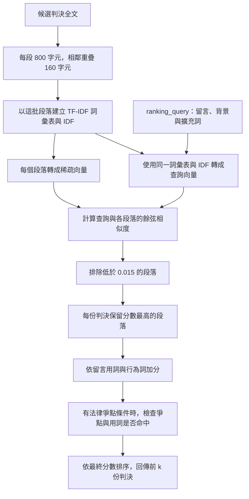
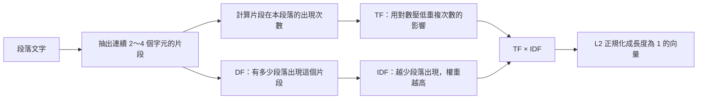
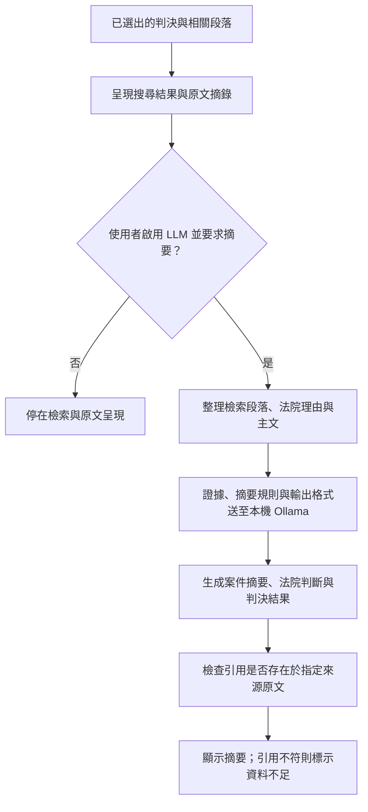
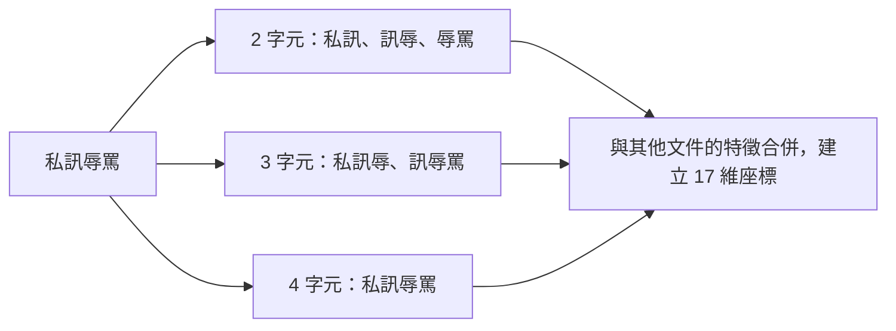
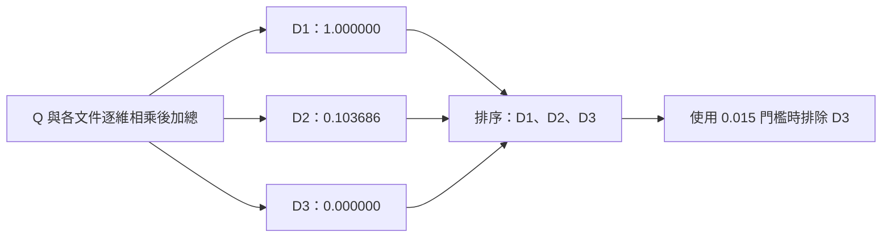
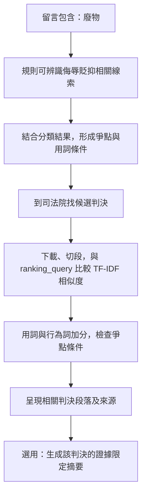
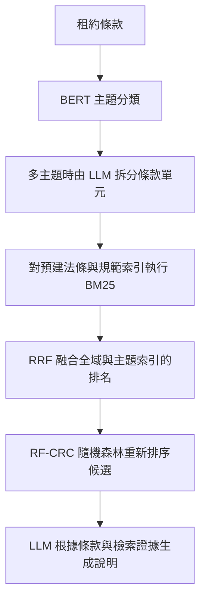

# 司法檢索系統：TF-IDF 流程與核心程式

這次 meeting 的範圍：回答「我的系統如何檢索？向量是什麼？與學長、IDEAL-RAG 有何不同？」先把這件事說清楚，再開始 MCP。以下依 **flowchart → 核心程式 → 具體例子** 排列。

核對依據：司法系統的實際呼叫鏈、先前的 `mini_rag.py`、學長的《完整結案報告》、IDEAL-RAG 原文。程式是靜態核對，沒有重新連線司法院或執行本機語言模型。數值例子使用自造短句，不是判決實驗成績。

## 先修正你的理解

| 原本的說法                 | 應改成                                                                                  |
| -------------------------- | --------------------------------------------------------------------------------------- |
| TF-IFD                     | 正確拼法是 **TF-IDF**。                                                                 |
| TF-IDF 會上網找文件        | TF-IDF 是文字表示與加權方法。你的程式另外呼叫司法院網站取得候選判決，再用 TF-IDF 排序。 |
| 選關鍵字命中最多的文件     | 你的系統比較加權向量的餘弦相似度，之後還有規則加分與篩選，並非單純計算命中數。          |
| 用全文詞頻                 | 程式先切段；TF 與 DF 是以這批「段落」計算。                                             |
| 之前的基礎 RAG 用 BM25     | **不是。**先前的 `outputs/mini_rag/mini_rag.py` 用預設關鍵字的命中個數計分。            |
| 有語意模型就是語意向量檢索 | 主流程的 mDeBERTa 做「分類」，沒有拿它的向量做判決相似度搜尋。                          |

開場可以直接說：

> 我的司法系統分成兩次篩選：先用分類結果與留言用詞，到司法院取得候選判決；再把候選判決切成段落，用字元 TF-IDF 與餘弦相似度排序，最後加上爭點與用詞規則。使用者另外啟用摘要功能時，才把證據交給本機 LLM。

## 1. 先用 flowchart 說明實際系統

### 1.1 第一層：上網取得候選判決



對應：`app.py`、`live_search.py::search_plan()`、`LiveJudicialSearch.search()`。

- 預設分類器是 mDeBERTa 的 NLI 模型，透過文字與分類假設判斷言論類型。它不是此處的文件 embedding 模型。
- `search_plan()` 結合原始留言、背景、規則詞與分類結果，形成官網查詢條件，以及後續本機排序的 `ranking_query`。
- 官網查詢使用程式組合的 AND／OR 條件；**不能因此斷言司法院網站底層使用 BM25**。
- 搜尋有階段、數量與時間限制，不是下載全部判決。TF-IDF 只能排序已取得的候選文件；第一層漏掉的判決，第二層救不回來。

### 1.2 第二層：本機如何選出判決



對應：`core.py::chunks()`、`retrieve()`、`live_search.py::rank_cases()`。

這是**目前主流程**。`rank_cases()` 沒有傳入 `encoder`，因此走 TF-IDF 分支。

注意：先選定每份判決的最佳 TF-IDF 段落，再做規則加分與篩選；不是把所有段落加完規則分數後，重新挑每份判決的最佳段落。

### 1.3 TF-IDF 向量裡的數字怎麼來



這裡的「詞」實際上是**字元 n-gram**，不一定是語言學上的完整詞。例如「私訊辱罵」會產生「私訊」「訊辱」「辱罵」「私訊辱」「訊辱罵」「私訊辱罵」。

### 1.4 哪一段才有 Generation？



對應：`app.py` 的 LLM 開關與摘要按鈕、`services.py::generate_summary()`。

**預設沒有開啟 LLM 摘要。**只檢索、顯示原文時，應稱為檢索系統；開啟生成後，可描述為「檢索增強的判決摘要」。目前摘要函式接收選出的判決，**沒有收到使用者原始問題**，不能直接說成「完整的法律問答 RAG」。

引用檢查只能確認引文存在，不能保證摘要推論正確，也不能證明判決適用於使用者的案件。

## 2. 再講主要核心程式

以下是閱讀用節錄；只有第 3.5 節是可獨立執行的小例子。

### 2.1 建立排序問題：不是只有原始 query

來源：`live_search.py::search_plan()` 的回傳值。

```python
'ranking_query': comment + ' ' + context + ' ' + ' '.join(legal + features)
```

- `comment`：使用者留言。
- `context`：背景。
- `legal`：爭點／法律相關詞。
- `features`：留言中辨識出的特徵用詞。

這是簡單的查詢擴充。詞可能同時出現在留言與擴充清單中，重複次數也會影響查詢向量。

### 2.2 切段、建立向量、計算相似度

來源：`core.py:68`、`core.py:77`；以下節錄主流程，省略例外處理與未啟用的 encoder 分支。

```python
pieces = chunks(docs)  # 預設每段 800 字元，重疊 160 字元

vectorizer = TfidfVectorizer(
    analyzer="char",
    ngram_range=(2, 4),
    max_features=100000,
    sublinear_tf=True,
)

matrix = vectorizer.fit_transform([p["text"] for p in pieces])
lexical = (matrix @ vectorizer.transform([query]).T).toarray().ravel()
scores = lexical.copy()
```

| 程式                      | 真正做的事                                                           |
| ------------------------- | -------------------------------------------------------------------- |
| `analyzer="char"`         | 用字元片段建立特徵，不做中文斷詞。                                   |
| `ngram_range=(2, 4)`      | 使用長度 2、3、4 的連續字元片段。                                    |
| `max_features=100000`     | 最多保留十萬個特徵；不是每次一定有十萬維。                           |
| `sublinear_tf=True`       | 出現次數 c 大於 0 時，TF 使用 `1 + ln(c)`。                          |
| `fit_transform(段落)`     | 從段落建立詞彙表、估計 IDF，再轉成矩陣；不是訓練 LLM。               |
| `transform(查詢)`         | 使用既有詞彙表與 IDF；不重新計算 IDF。未收錄的片段會被忽略。         |
| `matrix @ query_vector.T` | 每個段落向量與查詢向量做內積。預設已 L2 正規化，因此等於餘弦相似度。 |

假設有 P 個段落、V 個特徵：段落矩陣是 `P × V`；查詢向量是 `1 × V`；相乘得到 `P × 1` 個分數。

`TfidfVectorizer` 預設 `smooth_idf=True`、`norm="l2"`。因此這份程式的計算為：

```text
TF(t,d) = 1 + ln(出現次數)              若未出現則為 0
IDF(t)  = ln((1 + N) / (1 + DF(t))) + 1
原始權重 = TF × IDF
正規化權重 = 原始權重 / 向量的 L2 長度
```

N 是**本次候選判決切出的段落數**；DF 是其中多少段落含有該特徵。不是在整個網路統計稀有程度。每次呼叫 `retrieve()` 都會重新 fit，因此候選集合改變，IDF 與分數也可能改變。

餘弦相似度比較向量的方向：

```text
cos(q,d) = (q · d) / (||q|| × ||d||)
```

兩個非零向量已各自正規化為長度 1 時，分母等於 1，因此直接做內積即可。查詢完全沒有已知特徵時會得到零向量，這段程式算出的分數全部為 0。

公式與預設設定參考：[scikit-learn TfidfTransformer](https://scikit-learn.org/stable/modules/generated/sklearn.feature_extraction.text.TfidfTransformer.html)、[TfidfVectorizer](https://scikit-learn.org/stable/modules/generated/sklearn.feature_extraction.text.TfidfVectorizer.html)。

### 2.3 保留每份判決中最相關的段落

來源：`core.py::retrieve()`，此處以主流程的 TF-IDF 門檻呈現。

```python
best = {}
for i in np.argsort(-scores):  # 由高分到低分
    if scores[i] < 0.015:
        continue
    p = pieces[int(i)]
    if p["doc"]["id"] not in best:
        best[p["doc"]["id"]] = {**p, "score": float(scores[i])}
    if len(best) >= k:
        break
```

同一份判決可能有很多段。因為已按分數排序，第一次遇到某份判決時，就是它分數最高的段落。外層 `rank_cases()` 傳入的候選數是 `max(len(docs), k)`，再於規則處理後取最終前 k 份。

### 2.4 最終排名還包含規則

來源：`live_search.py:70`。以下省略預覽文字處理。

```python
candidates = retrieve(plan['ranking_query'], docs, max(len(docs), k))
for hit in candidates:
    evidence = [w for w in plan.get('features', []) if w in hit['text']]
    behavior = [w for w in plan.get('behavior_terms', []) if w in hit['text']]
    issues = [w for w in plan.get('legal_terms', [])
              if w in hit['text'] or w in hit['doc']['title']]
    hit['match_terms'] = list(dict.fromkeys(evidence + behavior))
    hit['issue_terms'] = issues
    hit['score'] += min(len(evidence), 3) * .08 + min(len(behavior), 2) * .025

if plan.get('legal_terms'):
    candidates = [h for h in candidates if h['issue_terms'] and h['match_terms']]
return sorted(candidates, key=lambda h: -h['score'])[:k]
```

```text
最終分數 = TF-IDF 餘弦相似度
         + min(命中的留言特徵詞數, 3) × 0.08
         + min(命中的行為詞數, 2) × 0.025
```

所以最後顯示的分數**不是純餘弦相似度，也不是相關機率**。規則最多加 0.29，最終分數可能大於 1。有法律爭點條件時，還必須同時通過「爭點命中」與「留言／行為用詞命中」的篩選。

### 2.5 生成端收到什麼

來源：`services.py:73`，節錄輸入整理；不是完整函式。

```python
doc = hit["doc"]
excerpts = extract(doc)
evidence = {"檢索段落": hit["text"], **excerpts}
source = json.dumps(evidence, ensure_ascii=False)
```

後續將 `source`、證據限定規則、JSON 輸出格式交給 Ollama。規定輸出三欄「案件摘要、法院判斷、判決結果」，每欄包含摘要 `text` 與原文 `quote`，再由 Python 驗證引用。

**`extract()` 是依標題等規則擷取主文與理由，不是呼叫 LLM 萃取內部知識。**它和 IDEAL-RAG 的 internal knowledge extraction 不是同一件事。

## 3. 具體例子：向量到底長什麼樣子？

以下是為方便手算而造的短句。每份文件只有一段；未加入查詢擴充與規則加分。使用與專案相同的字元 2～4 gram、TF-IDF 與 L2 設定。

### 3.1 輸入與切出的特徵

| 輸入   | 文字     |
| ------ | -------- |
| 查詢 Q | 私訊辱罵 |
| D1     | 私訊辱罵 |
| D2     | 私訊道歉 |
| D3     | 租金押金 |



每一維對應一個固定的字元片段。所有文件與查詢都使用相同的座標順序，才能相乘比較。

### 3.2 先算 TF、IDF，再正規化

這個例子所有特徵在各段內最多出現一次，所以非零 TF 都是 `1 + ln(1) = 1`。

- 「私訊」出現在 D1、D2，DF = 2，因此 IDF = `ln(4/3) + 1 ≈ 1.2877`。
- 其他特徵各只出現在一份文件，DF = 1，因此 IDF = `ln(4/2) + 1 ≈ 1.6931`。

共同用詞「私訊」比較常見，因此其辨識力權重較低。這是相對於這三份文件而言，不代表現實中這個詞一定常見。

D1 的原始向量有一個 1.2877、五個 1.6931，其餘為 0。

```text
D1 長度 = sqrt(1.2877² + 5 × 1.6931²) ≈ 3.9990
「私訊」的正規化權重 ≈ 1.2877 / 3.9990 = 0.3220
其他五個非零特徵的權重 ≈ 1.6931 / 3.9990 = 0.4234
```

D3 的六個特徵權重相同，正規化後每個約為 `1/sqrt(6) = 0.4082`。

### 3.3 完整的 17 維向量

| 維度（從 0 起） | 對應字元片段 |      Q |     D1 |     D2 |     D3 |
| --------------: | ------------ | -----: | -----: | -----: | -----: |
|               0 | 押金         |      0 |      0 |      0 | 0.4082 |
|               1 | 私訊         | 0.3220 | 0.3220 | 0.3220 |      0 |
|               2 | 私訊辱       | 0.4234 | 0.4234 |      0 |      0 |
|               3 | 私訊辱罵     | 0.4234 | 0.4234 |      0 |      0 |
|               4 | 私訊道       |      0 |      0 | 0.4234 |      0 |
|               5 | 私訊道歉     |      0 |      0 | 0.4234 |      0 |
|               6 | 租金         |      0 |      0 |      0 | 0.4082 |
|               7 | 租金押       |      0 |      0 |      0 | 0.4082 |
|               8 | 租金押金     |      0 |      0 |      0 | 0.4082 |
|               9 | 訊辱         | 0.4234 | 0.4234 |      0 |      0 |
|              10 | 訊辱罵       | 0.4234 | 0.4234 |      0 |      0 |
|              11 | 訊道         |      0 |      0 | 0.4234 |      0 |
|              12 | 訊道歉       |      0 |      0 | 0.4234 |      0 |
|              13 | 辱罵         | 0.4234 | 0.4234 |      0 |      0 |
|              14 | 道歉         |      0 |      0 | 0.4234 |      0 |
|              15 | 金押         |      0 |      0 |      0 | 0.4082 |
|              16 | 金押金       |      0 |      0 |      0 | 0.4082 |

把 D1 那一欄橫著看，就是一個向量：

```text
D1 = [0, .3220, .4234, .4234, 0, 0, 0, 0, 0,
      .4234, .4234, 0, 0, .4234, 0, 0, 0]
```

「稀疏」指大部分位置為 0。在大型詞彙表中，每段通常只用到少數特徵。稀疏矩陣可主要保存非零值及其位置；概念上 D1 只需記錄：

```text
位置 1 → .3220
位置 2、3、9、10、13 → 各 .4234
```

這是儲存概念，不是完整 CSR 格式。TF-IDF 向量也是 vector；**vector 並不等於神經網路產生的語意 embedding**。

### 3.4 相似度如何算出排名

因為已經正規化，逐維相乘再加總即可。下列結果以未四捨五入的權重計算。

```text
Q · D1 = 0.322002² + 5 × 0.423394² ≈ 1.000000
Q · D2 = 0.322002²                   ≈ 0.103686
Q · D3 = 0                          = 0.000000
```

| 文件        | 餘弦相似度 | 解釋                     |
| ----------- | ---------: | ------------------------ |
| D1 私訊辱罵 |   1.000000 | 與問題完全相同。         |
| D2 私訊道歉 |   0.103686 | 只共用「私訊」這個特徵。 |
| D3 租金押金 |   0.000000 | 沒有共同特徵。           |



這也直接展示限制：若把 Q 改成「傳訊息罵人」，意思接近 D1，但沒有任何共同的 2～4 字元特徵，三個分數會全部為 0。**字面檢索不保證辨識改寫與同義詞。**

### 3.5 在原本 VS Code 的 Python 環境直接觀察

這段可放進 Jupyter 的一個 cell。只需要原專案本來就使用的 scikit-learn，不需要模型、API、付費服務或路徑設定。

```python
from sklearn.feature_extraction.text import TfidfVectorizer

texts = ["私訊辱罵", "私訊道歉", "租金押金"]
query = "私訊辱罵"

vectorizer = TfidfVectorizer(
    analyzer="char", ngram_range=(2, 4),
    max_features=100000, sublinear_tf=True,
)
X = vectorizer.fit_transform(texts)
q = vectorizer.transform([query])
scores = (X @ q.T).toarray().ravel()

print("特徵座標：", vectorizer.get_feature_names_out().tolist())
print("文件矩陣形狀：", X.shape)
print("查詢向量：", q.toarray().round(6))
print("文件向量：\n", X.toarray().round(6))
print("相似度：", scores.round(6))

names = vectorizer.get_feature_names_out()
for i, text in enumerate(texts):
    row = X.getrow(i)
    pairs = sorted(zip(row.indices, row.data))
    print(text, [(names[j], round(float(w), 6)) for j, w in pairs])

alternative = vectorizer.transform(["傳訊息罵人"])
print("改寫後分數：", (X @ alternative.T).toarray().ravel())
```

預期：矩陣形狀 `(3, 17)`；相似度 `[1.0, 0.103686, 0.0]`；改寫後三個分數都是 0。

驗證範圍：本筆記的數字已用 Python 標準函式庫依相同公式計算；以上 cell 已做語法檢查。目前整理文件所用環境沒有 scikit-learn，沒有宣稱已在你的 VS Code kernel 實際執行。若出現套件找不到，先確認 Jupyter 選的是原司法專案的 Python 環境。

### 3.6 回到你的應用場景

使用者輸入：「他在留言區一直叫我廢物」，背景：「網路留言」。



這是依程式規則說明的輸入案例，沒有假裝跑出實際判決。假設某段的相似度是 0.20，命中一個留言特徵詞、一個行為詞，則最終分數是 `0.20 + 0.08 + 0.025 = 0.305`。這是算式示範，不是實測成績。

應用價值：把「使用者描述」連到「可查證的相關判決段落」，縮短找參考資料的時間。限制是文字相近不代表案件構成要件與事實相同；檢索分數不能當成勝訴或違法機率。

## 4. 回答老師：與學長、IDEAL-RAG 差在哪？

### 4.1 學長報告記載的流程



依《完整結案報告》描述，單一主題不需要拆分；未落入四類主題時走全域索引。檢索包含法條全域、法條主題、規範全域、規範主題等索引。

- **BM25**：字面檢索的評分方法，考慮詞頻、稀有程度、詞頻飽和與文件長度；不是 TF-IDF 向量再做 cosine 的同一套計算。
- **RRF**：根據多份排名中的名次融合候選，不是 embedding 模型。
- **RF-CRC**：隨機森林排序器，利用 RRF 分數、候選名次、主題符合程度、文字重疊等特徵。
- 報告 §4.4 最終設定的融合權重 α = 0，表示最終排序分數採 RF；RRF 仍參與候選融合與特徵提供。

以上是報告記載，未取得學長原始程式，不能稱為已核驗的執行結果。

### 4.2 三者不是在改同一個位置

| 面向       | 我的司法系統                   | 學長系統（依報告）           | IDEAL-RAG                            |
| ---------- | ------------------------------ | ---------------------------- | ------------------------------------ |
| 任務       | 從留言找相關判決，選用判決摘要 | 租約條款對應法條／規範與說明 | 面對檢索雜訊時，改善問答生成         |
| 候選來源   | 司法院網站搜尋後下載判決       | 預先整理與建立索引的法律資料 | 實驗資料集對應的檢索段落             |
| 檢索／排序 | 字元 TF-IDF cosine，再加規則   | BM25 → RRF → RF-CRC          | 使用既有檢索器，方法重點在生成端     |
| 生成處理   | 選用證據限定摘要與引文檢查     | 根據條款與證據生成說明       | 獨立回想 → 雙觀點 → linked rationale |

**不能只說「大家都是 RAG，所以差不多」。**要說明比較的是資料來源、文字表示、候選搜尋、排序，還是生成端的知識處理。

### 4.3 IDEAL-RAG 原文到底用哪種檢索器？

依原文 **Table 4.1**：

| 資料集            | 表列檢索器 | top-k |
| ----------------- | ---------- | ----: |
| PopQA             | Contriever |     5 |
| Natural Questions | DPR        |     5 |
| TriviaQA          | Contriever |     5 |
| 2WikiMultiHopQA   | BM25       |    10 |

Contriever、DPR 是稠密檢索模型；BM25 是字面檢索評分方法。**不能說這篇論文只用了 BM25，也不能說它提出新的向量資料庫。**

需要誠實註明：原文 §4.1.1 前文另寫到結合 BM25、DPR、Contriever 的「hybrid retriever」，與表格按資料集列出單一檢索器的呈現不完全一致。報告時說「依 Table 4.1 的設定」，不要把融合方式、權重或實作細節補成已知事實。原文這部分也不足以確認它採用 FAISS 或 Chroma。

### 4.4 學長提到的名稱分別在哪一層？

| 名稱                   | 屬於什麼                   | 負責什麼                                                 |
| ---------------------- | -------------------------- | -------------------------------------------------------- |
| TF-IDF                 | 稀疏文字表示／加權         | 將字詞或字元片段轉成有權重的向量；你的系統再算 cosine。  |
| BM25                   | 字面檢索評分方法           | 直接為查詢與候選文件的字面匹配評分。                     |
| nomic-embed            | 文字 embedding 模型系列    | 把文字轉成可比較的向量；要進一步確認實際版本。           |
| BGE-M3                 | 檢索用 embedding 模型      | 支援稠密、稀疏與多向量表示；使用哪種取決於設定。         |
| FAISS                  | 向量相似度搜尋與索引函式庫 | 建索引、搜尋近鄰；本身不把文字變成 embedding。           |
| Chroma                 | 向量資料庫                 | 管理向量、文件與 metadata，提供查詢與篩選。              |
| 你的 mDeBERTa NLI 模型 | 分類模型                   | 此程式用來判斷言論類型，沒有用來對判決建立語意向量索引。 |

概念上的向量檢索配置可以是：


這是說明工具位置的配置示意，**不是你的系統或學長報告已確認採用的流程**。FAISS 與 Chroma 不必一起使用；Chroma 可整合 embedding function，但資料庫與 embedding 模型仍是不同角色。

你的 `core.py` 確實預留了 `encoder` 分支，會混合 `0.45 × lexical + 0.55 × semantic`，並改用 320／64 字元切段與 0.16 門檻；但主流程沒有傳入 encoder。不能因為檔案裡存在這段程式，就說目前網站已啟用向量語意檢索。

學長報告中的 BGE-M3 出現在背景／比較討論，不足以證明最終系統採用它；FAISS、Chroma、Nomic 也不能僅憑學長提過名稱，就寫成實作設定。

工具定義參考：[FAISS 官方](https://github.com/facebookresearch/faiss)、[Chroma 官方](https://docs.trychroma.com/docs/overview/introduction)、[BGE-M3 model card](https://huggingface.co/BAAI/bge-m3)、[Nomic Embed model card 範例](https://huggingface.co/nomic-ai/nomic-embed-text-v1.5)。

### 4.5 我們以前的基礎練習不是 BM25

核對檔案：`outputs/mini_rag/mini_rag.py::retrieve()`。

它先從固定 `KEYWORDS` 中找出問題包含的詞，再數每份文件命中多少個，概念如下：

```python
query_terms = [term for term in KEYWORDS if term in question]
# 對每份文件：
matched = [term for term in query_terms if term in document_text]
score = len(matched)
```

這段是概念節錄。它沒有 BM25 的 IDF、詞頻飽和與文件長度校正，也沒有 TF-IDF cosine；只是為了學習「檢索 → 組合提示 → 生成」而使用的簡單檢索器。

## 5. 最後用這段收尾

> 我這次確認了三件事。第一，TF-IDF 不負責上網；我的系統先取得候選判決，再用字元 TF-IDF 與餘弦相似度做段落排序，之後還有規則篩選。第二，我使用的 mDeBERTa 是分類器，目前主流程沒有啟用語意向量檢索。第三，學長的方法著重 BM25 候選檢索、排名融合與重新排序，而 IDEAL-RAG 的主要改動在生成端，讓模型分開處理內部知識與外部文件。它們解決的是 RAG 流程中不同位置的問題。

報告時先走第 1 節流程，接第 2.2、2.4 節程式，再用第 3 節數字回答「向量怎麼長、相似度怎麼算」。老師問與學長或論文差異時，用第 4 節。這次不需要再增加模型或擴充新功能。
