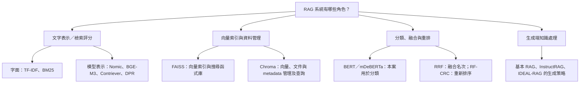
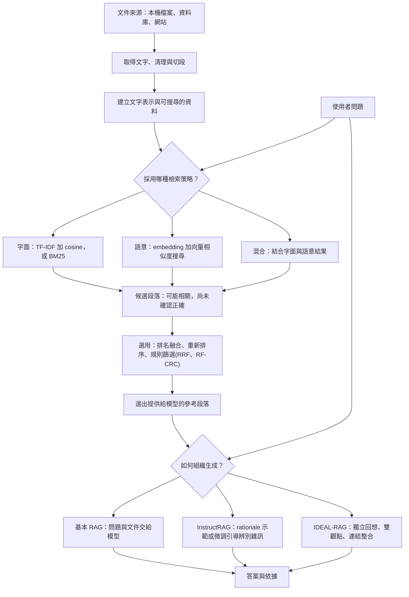
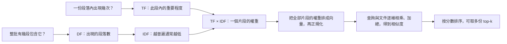
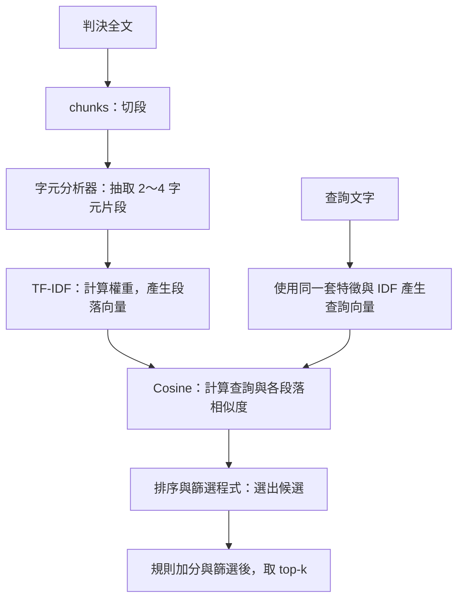
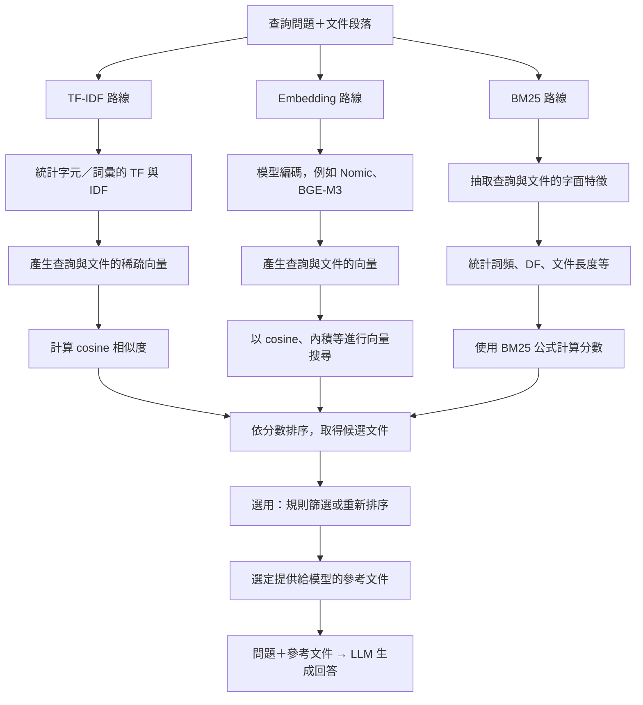

# RAG

## RAG 中的不同工具的角色分類



## 每個工具在整套流程中做甚麼(通用概念圖)




## 文字整理版

### RAG 生成端知識處理

| 名稱        | 是什麼／放在哪裡     | 輸入 → 處理 → 輸出                                                              |
| ----------- | -------------------- | ------------------------------------------------------------------------------- |
| RAG         | 檢索加生成的整體流程 | 問題 → 找參考資料並交給模型 → 回答                                              |
| InstructRAG | 檢索增強生成方法     | 透過 rationale 示範或微調(透過ICL 示範 or SFT 學習)，引導模型辨別文件雜訊後回答 |
| IDEAL-RAG   | 檢索增強生成方法     | 將回想、內外觀點、連結理由明確分開，引導知識使用                                |

### 文字表示與檢索評分

#### 文字表示

| 名稱            | 是什麼／放在哪裡                | 輸入 → 處理 → 輸出                                         |
| --------------- | ------------------------------- | ---------------------------------------------------------- |
| TF-IDF          | 文字表示與加權                  | 文字集合 → 統計詞頻與稀有程度 → 稀疏向量；再用 cosine 排序 |
| embedding 模型  | 把文字編碼成向量的模型          | 問題或段落 → 模型計算 → 向量；仍需比較／搜尋向量           |
| Nomic、BGE-M3   | 具體的 embedding 模型／模型系列 | 擔任上一列的編碼器；使用能力依版本與設定而定               |
| Contriever、DPR | 論文採用的稠密檢索模型          | 問題與文件 → 相容的向量表示與匹配 → 檢索候選               |

#### 檢索評分

| 名稱         | 是什麼／放在哪裡 | 輸入 → 處理 → 輸出                           |
| ------------ | ---------------- | -------------------------------------------- |
| cosine／內積 | 相似度計算       | 兩個向量 → 計算匹配程度 → 分數；不是生成答案 |

#### 綜合

| 名稱 | 是什麼／放在哪裡 | 輸入 → 處理 → 輸出                                   |
| ---- | ---------------- | ---------------------------------------------------- |
| BM25 | 字面檢索評分方法 | 問題、文件與語料統計 → 評估字面匹配 → 文件分數與排名 |

### 向量索引與資料管理

| 名稱   | 是什麼／放在哪裡     | 輸入 → 處理 → 輸出                                 |
| ------ | -------------------- | -------------------------------------------------- |
| FAISS  | 向量索引與搜尋函式庫 | 文件向量與查詢向量 → 搜尋近鄰 → ID 與距離／分數    |
| Chroma | 向量資料庫           | 向量、文件、metadata → 管理、篩選、搜尋 → 候選資料 |

### 分類、排名融合與重新排序

| 名稱                  | 是什麼／放在哪裡         | 輸入 → 處理 → 輸出                                     |
| --------------------- | ------------------------ | ------------------------------------------------------ |
| RRF                   | 名次融合方法             | 多份排名 → 按名次累計分數 → 合併排名                   |
| RF-CRC                | 學長系統的隨機森林排序器 | 候選的多種特徵 → 模型評分 → 更新候選順序               |
| BERT／mDeBERTa 分類器 | 在這些系統裡做分類       | 留言／條款 → 判斷主題或言論類型 → 類別；可協助搜尋條件 |

# TF-IDF

## 例子

```
D1：私訊、私訊、私訊、辱罵
D2：私訊、道歉
D3：租金、押金
```

| 名稱       | 完整名稱                   | 問的問題                           | 「私訊」的例子                              |
| ---------- | -------------------------- | ---------------------------------- | ------------------------------------------- |
| 原始次數 c | Count                      | 在這一份文件裡出現幾次？           | D1 是 3 次，D2 是 1 次                      |
| TF         | Term Frequency             | 如何把這份文件的出現次數轉成權重？ | 本程式 D1 用 `1 + ln(3)`；D2 用 `1 + ln(1)` |
| DF         | Document Frequency         | 有幾份文件包含它？每份最多算一次   | 出現在 D1、D2，所以 DF = 2，不是 4          |
| IDF        | Inverse Document Frequency | 依 DF 計算它在整批文件中的稀有程度 | N = 3，`ln((1+3)/(1+2))+1 ≈ 1.2877`         |

## Flowchart



## 文字分段

| 設定    | 「私訊辱罵」產生什麼        | 取捨                                               |
| ------- | --------------------------- | -------------------------------------------------- |
| `(1,1)` | 私、訊、辱、罵              | 較容易共享字元，也較容易因單字相同而誤配           |
| `(2,2)` | 私訊、訊辱、辱罵            | 保留局部順序，比單字更具體                         |
| `(2,4)` | 同時包含 2、3、4 字元片段   | 同時保留短片段與較完整片語，特徵較多               |
| `(5,5)` | 這句只有 4 字，沒有任何特徵 | 太長可能讓短查詢無法匹配；若整批都太短，fit 會失敗 |

## 問題

### BM25 跟 TF-IDF 是不是很像?

`BM25`與`TF-IDF` + `Cosine` 目的相近: _為查詢找出相關文件_
差別在如何計算分數

例如在比賽中使用的 _查詢相關判決書_ 功能:



### 是如何切割文本的?

並不是TF-IDF或是BM25做的 而是Chunk

### 那BM25 跟 TF-IDF+Cosine 差別在哪?

|                | TF-IDF＋cosine                 | BM25                                     |
| -------------- | ------------------------------ | ---------------------------------------- |
| 怎麼算         | 先建立文字向量，再比較向量方向 | 依查詢中的匹配詞，累加文件分數           |
| 重複次數       | 你的版本使用對數 TF            | 使用詞頻飽和機制，次數越多，額外收益越小 |
| 文件長度       | cosine 正規化控制向量長度影響  | 公式明確考慮文件長度相對於平均長度       |
| 是否理解同義句 | 不保證                         | 不保證                                   |

### Embedding模型如何

```
分類：
「傳訊息罵人」 → 「侮辱」這個類別

Embedding：
「傳訊息罵人」 → [0.12, -0.37, 0.58, ...]
```

Embedding 模型把文字放到可比較的向量空間。適合檢索的模型可能讓「传訊息罵人」與「私訊辱罵」比較接近，不需要先把兩句都分類成「侮辱」


### Flowchart of three method(TF-IDF、Embeddgin、BM25)


