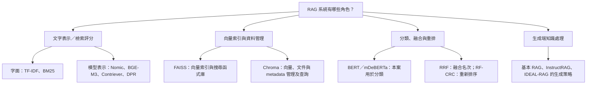
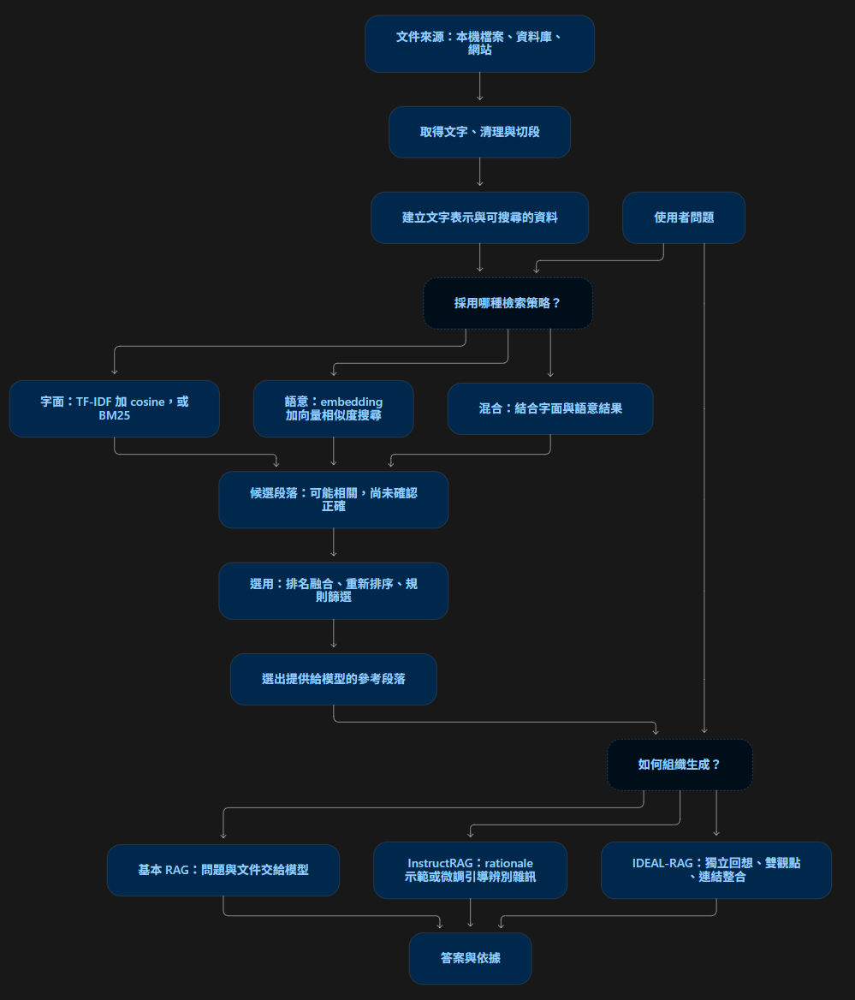
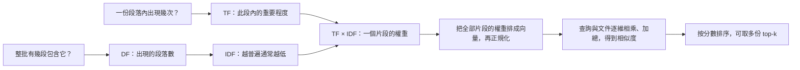

# RAG

## RAG 中的不同工具的角色分類

## 每個工具在整套流程中做甚麼(通用概念圖)

## 文字整理版

### RAG 生成端知識處李

| 名稱        | 是什麼／放在哪裡     | 輸入 → 處理 → 輸出                                                              |
| ----------- | -------------------- | ------------------------------------------------------------------------------- |
| RAG         | 檢索加生成的整體流程 | 問題 → 找參考資料並交給模型 → 回答                                              |
| InstructRAG | 檢索增強生成方法     | 透過 rationale 示範或微調(透過ICL 示範 or SFT 學習)，引導模型辨別文件雜訊後回答 |
| IDEAL-RAG   | 檢索增強生成方法     | 將回想、內外觀點、連結理由明確分開，引導知識使用                                |

### 檢索策略/評分

| 名稱            | 是什麼／放在哪裡                | 輸入 → 處理 → 輸出                                                 |
| --------------- | ------------------------------- | ------------------------------------------------------------------ |
| TF-IDF          | 文字表示與加權                  | 文字集合 → 統計詞頻與稀有程度 → 稀疏向量；你的程式再用 cosine 排序 |
| BM25            | 字面檢索評分方法                | 問題、文件與語料統計 → 評估字面匹配 → 文件分數與排名               |
| embedding 模型  | 把文字編碼成向量的模型          | 問題或段落 → 模型計算 → 向量；仍需比較／搜尋向量                   |
| Nomic、BGE-M3   | 具體的 embedding 模型／模型系列 | 擔任上一列的編碼器；使用能力依版本與設定而定                       |
| Contriever、DPR | 論文採用的稠密檢索模型          | 問題與文件 → 相容的向量表示與匹配 → 檢索候選                       |
| cosine／內積    | 相似度計算                      | 兩個向量 → 計算匹配程度 → 分數；不是生成答案                       |

### 向量索引與資料管理

| 名稱   | 是什麼／放在哪裡     | 輸入 → 處理 → 輸出                                 |
| ------ | -------------------- | -------------------------------------------------- |
| FAISS  | 向量索引與搜尋函式庫 | 文件向量與查詢向量 → 搜尋近鄰 → ID 與距離／分數    |
| Chroma | 向量資料庫           | 向量、文件、metadata → 管理、篩選、搜尋 → 候選資料 |

### 分類融合與重排(??????)

| 名稱                  | 是什麼／放在哪裡         | 輸入 → 處理 → 輸出                                     |
| --------------------- | ------------------------ | ------------------------------------------------------ |
| RRF                   | 名次融合方法             | 多份排名 → 按名次累計分數 → 合併排名                   |
| RF-CRC                | 學長系統的隨機森林排序器 | 候選的多種特徵 → 模型評分 → 更新候選順序               |
| BERT／mDeBERTa 分類器 | 在這些系統裡做分類       | 留言／條款 → 判斷主題或言論類型 → 類別；可協助搜尋條件 |

## Judgment_Assistant(TF-IDF)

TF-IDF
