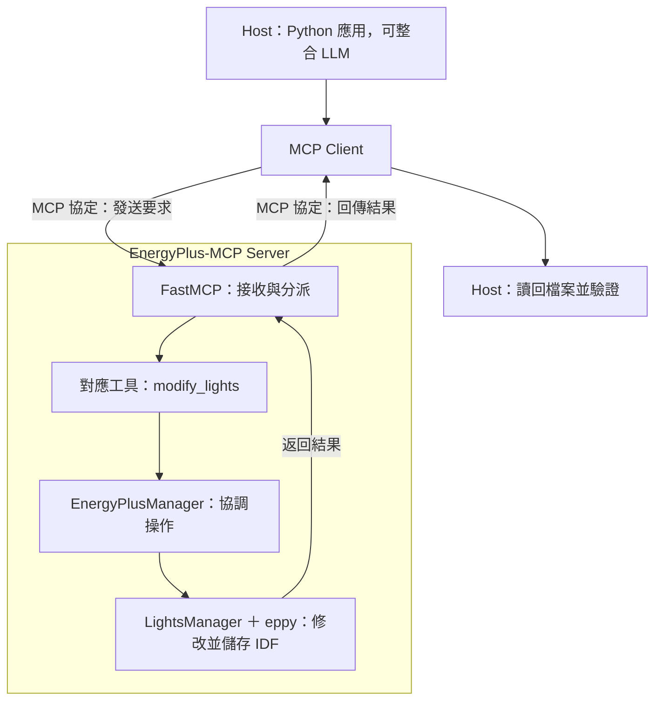

# EnergyPlus-MCP

# Implementation of EnergyPlus-MCP in Author's Github

https://github.com/LBNL-ETA/EnergyPlus-MCP

## 工具架構圖:

| 原圖區塊                             | 區塊內部元件                                                                                                 |
| :----------------------------------- | :----------------------------------------------------------------------------------------------------------- |
| MCP Client                           | IDEs(開發環境)、AI 助手、新的 BEM 應用程式                                                                   |
| MCP Protocol layer(協定層)           | FastMCP 伺服器、MCP 工具                                                                                     |
| Orchestration Layer(協調層)          | EnergyPlus Manager、核心設定模組                                                                             |
| Tools Layer (工具層)                 | 模型設定與載入（9 個工具）；模型檢查（9 個）；模型修改（8 個）；模擬與結果（4 個）；伺服器管理與日誌（5 個） |
| EnergyPlus Integration Layer(整合層) | 模擬引擎：EnergyPlus；檔案系統：IDF 檔、氣象檔                                                               |

## 縮寫（Acronyms）

| 縮寫 | 英文全名                                    | 中文                  |
| :--- | :------------------------------------------ | :-------------------- |
| AEC  | Architecture, Engineering, and Construction | 建築、工程與營建      |
| API  | Application programming interface           | 應用程式介面          |
| BEM  | Building energy modeling                    | 建築能耗建模          |
| FMU  | Functional mockup unit                      | 功能模擬單元          |
| HVAC | Heating, ventilation, air-conditioning      | 暖氣、通風與空調      |
| IDE  | Integrated development environment          | 整合開發環境          |
| IDF  | EnergyPlus input data file                  | EnergyPlus 輸入資料檔 |
| MCP  | Model context protocol                      | 模型上下文協定        |
